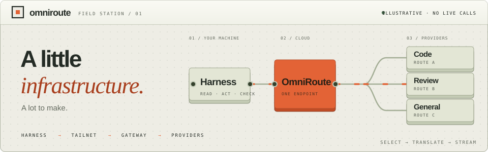

# OMNIROUTE FIELD STATION

**A playable map of one idea: a small box, a private link and a router that keeps an AI agent working. This is the mind map for a pipeline I want to make easy for everyone.**

```
UNIT     OMNIROUTE-FIELD-STATION
TYPE     SIMULATOR
STACK    HTML / CSS / JS, ONE FILE
STATUS   ACTIVE — MIND MAP, NOT A PRODUCT YET
```

[**Open the live station**](https://bortknox.github.io/omniroute-field-station/) · [**Roadmap**](docs/ROADMAP.md) · [**Sources**](#sources)

## WHAT THIS IS

An interactive page that follows one request through the whole chain and lets you break things on purpose:
trip a rate limit and watch the router fail over, shrink a noisy tool log, empty the free pool and see what
happens, compare a direct Tailscale path with a relayed one. There are no API calls and no credentials. It
is the architecture, made playable.

It is also my own working diagram. I lay a pipeline out here first, because if I cannot explain it as a
picture, I cannot build a tool for it.

## THE PIPELINE

| Stage | Part | Job |
|---|---|---|
| **01 / YOUR MACHINE** | DeepSeek Harness (`dsh`) | The doer. Loops think, use a tool, observe. Files, shell and MCP tools are plugins. |
| **02 / PRIVATE LINK** | Tailscale | Reach the gateway over your tailnet, with no public application port required. |
| **03 / YOUR CLOUD** | OmniRoute on a cloud host | One endpoint, many routes. Selects, translates and streams, with fallbacks when a route fails. |
| **04 / PROVIDERS** | Model providers | Eligible routes by role: code, review, general. Quotas and terms still apply. |
| **+ CONTEXT** | RTK and Caveman | Filter noisy tool output and condense prose so the next step carries less. |

Three ideas run through it:

1. **Keep your machine light.** Inference happens upstream. Move the harness to a capable cloud host to move
   shell work off the laptop too.
2. **Give every request options.** Route by capability, health, quota or cost. A good fallback keeps the job
   moving.
3. **Keep your front door closed.** Use the tailnet, not a public port.

## THE LONG GAME

This page is step one. The aim is a single tool that streamlines the whole chain: provision the host, wire the
private link, point the harness at the gateway, verify each hop, and keep it healthy. See the
[roadmap](docs/ROADMAP.md) for how I think that gets built. It is a direction, not a promise.

## RUN IT

It is one self-contained file with no build step and no network calls.

```bash
git clone https://github.com/BortKnox/omniroute-field-station.git
cd omniroute-field-station
start index.html        # Windows
# open index.html       # macOS
```

To preview it with working relative links, serve the folder (`python -m http.server`) and open
<http://localhost:8000/>.

## LAYOUT

```
index.html        # the station: markup, styles and script in one file
assets/           # banner
docs/ROADMAP.md   # from mind map to a tool
LICENSE           # MIT
```

## NOTES

- This is an independent educational simulation, not a live dashboard or a deployment of the stack. Timings,
  route roles, quotas and token counts are illustrative, and the compression figures are teaching estimates,
  not a benchmark.
- Free infrastructure is real, and so are its limits. Whether the whole stack fits on a 1 GB Always Free Micro
  is **not established**; treat it as an experiment and measure real memory use.
- OmniRoute does not make paid models free. Free routes need a real free pool, and when it is exhausted a
  request must wait or fail.
- Tailscale protects the device-to-gateway leg. Requests from the gateway to providers still leave over HTTPS.
- Researched 19 Nov 2026. Release behaviour changes, so pin and verify your versions.

Personal project, shared as is. Issues and pull requests may not get a reply; forking is welcome.

## SOURCES

Primary documentation and source shaped the station.

- [OmniRoute](https://github.com/cheaper-inference/OmniRoute) — [architecture](https://github.com/cheaper-inference/OmniRoute/blob/main/docs/architecture/ARCHITECTURE.md), [resilience](https://github.com/cheaper-inference/OmniRoute/blob/main/docs/architecture/RESILIENCE_GUIDE.md), [Auto-Combo](https://github.com/cheaper-inference/OmniRoute/blob/main/docs/routing/AUTO-COMBO.md), [compression](https://github.com/cheaper-inference/OmniRoute/blob/main/docs/compression/COMPRESSION_ENGINES.md)
- [DeepSeek Harness](https://github.com/deepseek-ai/deepseek-harness) — [architecture](https://github.com/deepseek-ai/deepseek-harness/blob/master/docs/architecture.md)
- [Tailscale](https://github.com/tailscale/tailscale) — [firewall ports](https://tailscale.com/docs/reference/faq/firewall-ports), [free plan eligibility](https://tailscale.com/docs/account/manage-plans/free-plans-discounts)
- Oracle Cloud — [compute shapes](https://docs.oracle.com/en-us/iaas/Content/Compute/References/computeshapes.htm), [Always Free resources](https://docs.oracle.com/en-us/iaas/Content/FreeTier/freetier_topic-Always_Free_Resources.htm)

## LICENSE

MIT — see [LICENSE](LICENSE).
